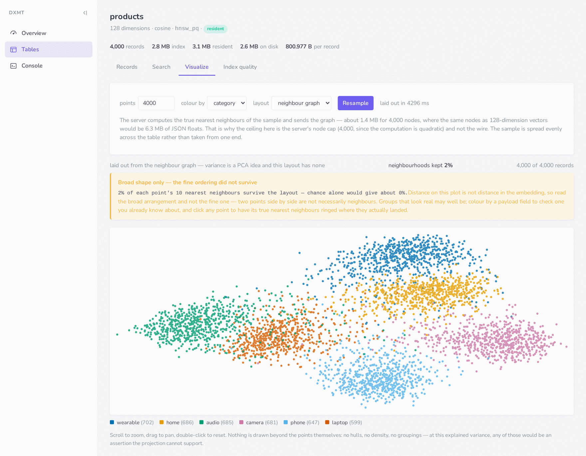

<p align="center">
  <a href="https://github.com/dxmt/dxmt">
    
  </a>
</p>

<h3 align="center">The open-source memory database for personal agents. Owned by you.</h3>

<p align="center">
  One persistent, portable memory of you and your work, shared by every agent you use --<br>
  Claude, Cursor, ChatGPT, your own code -- kept on your machine, in one binary.<br>
  Written in Rust. Apache-2.0.
</p>

<p align="center">
  <a href="https://github.com/dxmt/dxmt/actions/workflows/ci.yml"></a>
  <a href="https://github.com/dxmt/dxmt/releases"></a>
  <a href="https://pypi.org/project/dxmt-python-sdk/"></a>
  <a href="https://www.npmjs.com/package/dxmt-js-sdk"></a>
  <a href="https://crates.io/crates/dxmt-client"></a>
  <a href="https://hub.docker.com/r/dxmtai/dxmt"></a>
  <a href="LICENSE"></a>
</p>

<p align="center">
  <a href="#quick-start">Quick start</a> ·
  <a href="#memory-for-personal-agents">Agent memory</a> ·
  <a href="#clients-and-integrations">Clients &amp; integrations</a> ·
  <a href="#performance">Performance</a> ·
  <a href="vectordb/README.md">Manual</a> ·
  <a href="vectordb/docs/SUPPORT_MATRIX.md">What is supported</a>
</p>

<p align="center">
  
</p>

## Why DXMT

- **Memory, not just vectors.** An agent `remember`s a fact, a preference, an event or an instruction and `recall`s it later by meaning *and* keyword; a new fact **supersedes** an old one, which is kept as history; `forget` on request. Recall is measured on LoCoMo and LongMemEval, not asserted.
- **Yours.** Local-first: the data lives in `~/.dxmt`, embeddings come from a local model unless you choose otherwise, every memory can be listed, edited, exported and deleted, and every agent on your machine shares the one store over MCP or REST. No account, no cloud, Apache-2.0.
- **Every agent, one memory.** MCP over stdio and HTTP, a REST API, and Python, JavaScript, Rust and Go clients, all reading and writing the same store. Several MCP clients on one machine share it through one server automatically.
- **Recall by meaning and by keyword.** Chinese and English alike; a local multilingual model (bge-m3 through ollama) is the default, and any OpenAI-compatible embedding endpoint works instead.
- **A real database underneath, not a layer over someone else's.** Its own storage and indexes: a write-ahead log with snapshots (`kill -9` loses nothing acknowledged), HNSW and HNSW-PQ vector search, BM25 full-text, hybrid fusion, payload filters, backups, and object-storage replication when one machine is not enough. One 22 MB binary.
- **Measured, not claimed.** Memory recall on LoCoMo and LongMemEval; search recall and throughput on 1M, 10M and 100M vectors. Every number below links to the run that produced it.

## Quick start

**Run the server.** Linux (x86_64, aarch64) and macOS binaries are on [Releases](https://github.com/dxmt/dxmt/releases); or Docker; or `cargo build --release` in `vectordb/`.

```bash
# binary
v=1.6.0; arch=$(uname -m)
curl -L https://github.com/dxmt/dxmt/releases/download/v$v/dxmt-vectordb-$v-$arch-linux-gnu.tar.gz | tar xz
./dxmt-vectordb-$v-$arch-linux-gnu/vectordb serve          # http://127.0.0.1:9999, console at /dashboard

# docker
docker run -d --name dxmt -p 127.0.0.1:9999:9999 -v dxmt:/data dxmtai/dxmt:latest
```

With an embedding model the server can reach (`ollama pull bge-m3`, or `OPENAI_API_KEY`), the `kb` table is made by its first write and takes text:

```python
# pip install dxmt-python-sdk
from dxmt import Client, Field

db = Client(host="localhost", port=9999)
db.insert_records("kb", [
    {"id": "1", "text": "HNSW is a graph index for approximate nearest-neighbour search", "payload": {"lang": "en"}},
    {"id": "2", "text": "Python 的 GIL 限制了多线程并行",                                  "payload": {"lang": "zh"}},
    {"id": "3", "text": "A write-ahead log makes every acknowledged write survive a crash",  "payload": {"lang": "en"}},
])
db.hybrid_search("kb", text="why can't Python use all my cores", limit=2)     # meaning + keywords: finds the Chinese note
db.search("kb", text="graph index", limit=2, filter=Field("lang") == "en")   # vector search with a payload filter
```

The same store takes ordinary vector workloads too: `create_table(name, dimension=768)`, insert records with `vector`, search with `vector` and a filter. Everything is `curl`-able under `/api/v1`; the [manual](vectordb/README.md#quick-start) walks through tables, filters, documents, facets, geo and gRPC.

## Memory for personal agents

The same binary is an MCP server. One line gives an agent `remember`, `recall`, `forget` and `list_memories`, and every other agent on the machine sees the same memory:

```bash
claude mcp add dxmt -- vectordb mcp     # Claude Desktop and Cursor take the same command in their MCP config
```

The same memory is on REST and in every client:

```python
db.remember("Prefers answers in Chinese", kind="preference", source="me")
db.remember("Moved to Berlin", kind="fact", supersedes=["mem-…"])     # the old fact stays as history
db.recall("how should answers be written")                            # by meaning and by keyword
```

A memory has a kind, tags, a source and a time; recall is filtered by any of them. Measured on [LoCoMo](vectordb/docs/SUPPORT_MATRIX.md) the turns holding the answer are in the top 10 of `recall` for 69% of questions, and on all 470 questions of LongMemEval-S every answer session is in the top 10 for 80%. The memory layer decides *what* to keep and how it is recalled; the database underneath is why that recall is fast and survives anything.

## Clients and integrations

| | Install | Use |
| --- | --- | --- |
| Python | `pip install dxmt-python-sdk` | `from dxmt import Client` |
| JavaScript / TypeScript | `npm install dxmt-js-sdk` | `import { DXMTClient } from "dxmt-js-sdk"` |
| Rust | `dxmt-client = "1.6"` | `use dxmt_client::Client` |
| Go | `go get github.com/dxmt/dxmt/vectordb/clients/dxmt-go-sdk` | |
| LlamaIndex | `pip install llama-index-vector-stores-dxmt` | `from llama_index.vector_stores.dxmt import DXMTVectorStore` |
| LangChain | `pip install "git+https://github.com/dxmt/dxmt#subdirectory=vectordb/clients/langchain-dxmt"` | `from langchain_dxmt import DXMTVectorDB` |
| LangGraph | in `dxmt-python-sdk` | `from dxmt.langgraph_store import DXMTLangGraphStore` |
| Haystack | in `dxmt-python-sdk` | `from dxmt.haystack import DXMTDocumentStore` |
| mem0 | in `dxmt-python-sdk` | `from dxmt.mem0 import DXMTMemoryStore` |

[`SUPPORT_MATRIX.md`](vectordb/docs/SUPPORT_MATRIX.md) says exactly which routes each client wraps; everything else is one raw request away, because every capability is in the HTTP API.

## Performance

Memory recall is measured above. The database under it is measured on public vector benchmarks: one machine, 32 vCPU and local NVMe, one binary, ingested over REST; Cohere 768-d vectors for 1M and 10M rows, LAION for 100M. Full tables, methods and the client-overhead caveat are in the [manual](vectordb/README.md#measured-performance).

| Corpus | Ingest | Resident memory | recall@100 | QPS | p99 |
| --- | --- | --- | --- | --- | --- |
| 768d × 1M | 166 s | 610 MB | 0.980 | 6,465 | 3.6 ms |
| 768d × 10M | 23 min | 4.7 GB | 0.963 | 5,645 | 4.4 ms |
| 768d × 100M (fp16) | 3.75 h | 44.7 GB | 0.974 | 4,886 | 5.7 ms |

`search_mode: "exact"` scores every row so you can measure recall on your own data; the server runs that comparison itself and tunes its search budget to a `recall_target` per table.

## What is inside

- **Indexes.** HNSW, and HNSW-PQ whose graph walks on product-quantised codes with an exact rerank from the row file, so 100M rows fit in 45 GB. Full-text is Tantivy with jieba for Chinese. Every payload field is indexed unless the table says otherwise; geo radius and box filters; facets.
- **Storage.** Records and vectors live in row files beside a write-ahead log; snapshots compact the log; backups and `restore` are one command. Optional mirroring to S3-compatible object storage, read replicas with automatic failover, and an experimental cluster mode.
- **Interfaces.** REST under `/api/v1` with an OpenAPI document and Swagger UI, gRPC, MCP over stdio and HTTP, a read-only web console, and DXQL for `SELECT`-style queries.
- **Embedding and reranking on the server.** A table names a model; keys stay in the server's environment and are never in a request body or a snapshot.

## Status

1.6. The compatibility promise covers the HTTP API under `/api/v1` and the clients' public surfaces. It does **not** cover anything [`SUPPORT_MATRIX.md`](vectordb/docs/SUPPORT_MATRIX.md) marks experimental; read it, and [Known Limitations](vectordb/README.md#known-limitations), before depending on DXMT for real data. Everything lives under [`vectordb/`](vectordb/) — the server crate and the client packages; every `cargo` and `make` command runs from there.

| | |
| --- | --- |
| The manual: API, storage model, configuration, operations | [`vectordb/README.md`](vectordb/README.md) |
| What each client covers, what is experimental | [`vectordb/docs/SUPPORT_MATRIX.md`](vectordb/docs/SUPPORT_MATRIX.md) |
| Changes by version | [`vectordb/CHANGELOG.md`](vectordb/CHANGELOG.md) |
| Building, testing, pull requests | [`CONTRIBUTING.md`](CONTRIBUTING.md) · [`SECURITY.md`](SECURITY.md) · [`CODE_OF_CONDUCT.md`](CODE_OF_CONDUCT.md) |

## License

Apache License 2.0. See [LICENSE](LICENSE) and [NOTICE](vectordb/NOTICE).
